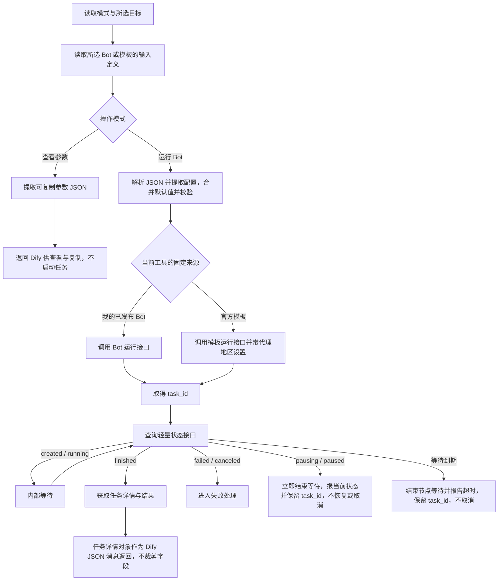

# Run a Bot：接口选型与内部编排

更新日期：2026-10-19。

统一评审入口：[首版设计方案 v0.8](04-review-design.md)。本页记录接口与编排；两个按来源区分的工具及各自的两种操作模式已确认，其他未决分支的建议见评审稿。

状态：基于已确认功能范围整理的接口与编排草案，供后续方案评审；尚未实现或联调。接口路径与用途已核对官方 [V3 OpenAPI](https://docs.browseract.com/openapi_3.json)。最新业务输入方案为 JSON 覆盖默认值，不依赖动态生成业务表单。

## 已确认的功能边界

首版在一个 BrowserAct 插件内开放“运行我的 Bot”和“运行官方模板”两个工具。每个工具的来源固定，各自在同一节点提供“查看参数”和“运行 Bot”，新建节点默认“查看参数”，由用户手动切换到运行模式：查看模式只读取输入定义，仅返回可复制修改的参数值对象；运行模式使用业务 JSON 覆盖默认值，启动后内部轮询并返回结果。两个工具共享 Provider 凭据和内部适配逻辑。范围以 [首版工具范围与输入方式](01-tools-and-input.md) 为准。

用户本轮确认以这一运行能力为范围，接下来确定接口与内部编排。本草案不继续细化轮询间隔、重试次数等配置。

## 拟采用的接口

所有路径基于 `https://api.browseract.com`，使用 `Authorization: Bearer <API_KEY>`。

| 阶段 | 用途 | 方法与路径 | 适用来源 |
| --- | --- | --- | --- |
| 配置节点 | 加载可运行的已发布 Bot 列表 | `GET /v3/bots` | 我的已发布 Bot |
| 配置节点 | 加载官方模板列表 | `GET /v3/bots/templates` | 官方模板 |
| 查看参数 / 运行 Bot | 读取 Bot 输入定义，供默认值提取或运行校验 | `GET /v3/bots/{bot_id}` | 我的已发布 Bot |
| 查看参数 / 运行 Bot | 读取模板输入定义，供默认值提取或运行校验 | `GET /v3/bots/templates/{template_id}` | 官方模板 |
| 配置节点 | 加载代理地区选项 | `GET /v3/bots/regions` | 官方模板 |
| 运行 Bot | 启动 Bot 任务 | `POST /v3/bots/{bot_id}/runs` | 我的已发布 Bot |
| 运行 Bot | 启动模板任务 | `POST /v3/bots/templates/{template_id}/runs` | 官方模板 |
| 运行 Bot | 内部轮询任务状态 | `GET /v3/bots/runs/{task_id}/status` | 两者共用 |
| 运行 Bot | 获取任务详情与业务结果 | `GET /v3/bots/runs/{task_id}` | 两者共用 |

合计仍为 9 个不同接口，服务于两个工具。“运行我的 Bot”固定使用 Bot 列表/详情/启动接口，“运行官方模板”固定使用模板列表/详情/启动接口并独立声明代理地区；两者共用状态与详情接口。“查看参数”复用各自详情接口，不新增 API。列表接口需要处理分页，避免遗漏后续页面中的目标。

官方说明明确推荐轻量 status 接口用于轮询；业务结果由任务详情接口取得。

## 内部编排

### 配置节点

1. 使用已配置的 BrowserAct API Key。
2. 根据所选工具加载对应列表：“运行我的 Bot”调用 `GET /v3/bots`，“运行官方模板”调用 `GET /v3/bots/templates`。工具入口已确定来源，不需要动态选项 hook 接收兄弟字段。
3. 用户从动态下拉选项中选择 Bot 或模板；首版不要求关键词搜索。
4. 官方模板额外加载并展示代理地区选项，默认美国；模板运行前校验必须是接口提供的有效值，查看模式不要求该值。
5. 需要了解参数时，选择“查看参数”并单步运行；点击 Dify 只读结果编辑器的“复制全部输出”，整体粘贴到固定的业务 JSON 字段，修改其中 `json[0]` 的参数。运行前由插件提取配置，忽略外层 `text`、`files`。
6. 用户切回“运行 Bot”，完成业务 JSON 与通用设置；已有参数的用户可直接配置运行模式。

选择 Bot 后不会自动重新生成业务字段或回填 JSON；点击“运行此步骤”并收到结果后，也不会把输出写回当前节点的 JSON 配置。可复制的参数值对象通过显式执行“查看参数”取得，不附带说明，输出约定见 [功能范围](01-tools-and-input.md#查看参数模式与输出)。代理地区仅在模板工具的固定 Schema 中声明，不依赖按来源条件显示，证据见 [动态输入参数调研](../research/02-bot-input-parameters.md)。

### 执行节点

此图表示主流程，不定义完整状态机。暂停、失败、取消和请求异常均不能被当作成功；查询到 `pausing/paused` 时立即停止轮询，节点报当前状态并保留 `task_id`，不恢复或取消远端任务，此项已确认。等待到期已确认：停止轮询，节点报告等待超时并保留 `task_id`，不取消远端任务。

查看模式只要求有效连接和明确目标，不解析或校验业务 JSON，也不使用代理地区或任务等待时限。仅从 `input_schema` 提取明确默认值，以实际参数值对象返回，不附带说明、Schema 或额外业务包装。无默认值时不虚构占位，缺失必填项在运行时校验；Schema 有效但无默认值时返回 `{}`，Schema 缺失时报节点错误。查看成功不意味着默认配置一定满足运行要求，不产生 `task_id`。Dify 仍展示原生外层结构，不插入独立 JSON 框或复制组件。

Dify 的“运行此步骤”只运行当前节点，不自动执行下游；完整工作流的“测试运行”才按连线继续。无论操作模式是什么，节点成功后是否继续下游由 Dify 的执行入口决定。查看模式在完整工作流中也可能把参数对象交给下游，不能把它描述成工作流自动停止或自动切回运行模式。

运行模式重新读取输入定义，避免把此前查看结果当作永远有效的定义。业务输入在用户界面使用 JSON；完整 Dify 输出由插件提取唯一的 `json[0]` 参数对象，忽略外层 `text`、`files`，保留纯参数对象输入。格式错误时不创建任务。随后将明确提供的默认值与用户输入逐层合并：同一路径均为对象时递归合并，数组整体替换，其他显式用户值优先。校验后构造 API 要求的 `input` 对象；必填且无默认值的缺失字段提示补充。空输入或 `{}` 表示不覆盖默认值。模板运行请求必须带有效的 `proxy_region`，默认美国，空值或无效值不创建任务；普通 Bot 运行不发送该字段。两类任务创建成功均取得 `task_id`，后续使用同一组任务接口。

## 本草案未纳入的接口与机制

- 不需要历史任务列表或恢复任务接口来完成当前主流程。
- 不使用回调：启动请求不配置 `callback_url` 或 `status_change_callback_url`。
- 取消接口 `POST /v3/bots/runs/{task_id}/cancel` 不纳入首版编排。R2 已确认超时只结束节点等待，保留 `task_id`，不取消远端任务。

## 评审时需要收敛

- 在目标 Dify 中验证两个工具各自的动态列表和固定字段，以及完整 `text/json/files` 展示、“复制全部输出 → 整体粘贴 → 修改 json[0] → 插件提取”的体验；验证不输出说明或额外业务包装、不写回当前节点 JSON 配置。
- R3 已确认对齐自家 n8n/Zapier：返回 API 任务详情 JSON，保留原字段及文件链接，不按白名单裁剪，不下载转存为 Dify `files`；验证下游消费和大结果兼容性，收敛其他未成功完成时的反馈。
- 默认 600 秒等待时限在目标平台的兼容性及允许范围；验证到期报告超时、保留 `task_id` 且不取消远端任务。

2026-10-19 已通过真实 API Key 只读查询列表及两个 Bot、六个模板详情，见 [API 实测](../research/evidence/2026-10-19-bot-api/README.md)；未保存凭据，未启动或取消真实任务，未实施 Dify 插件。
