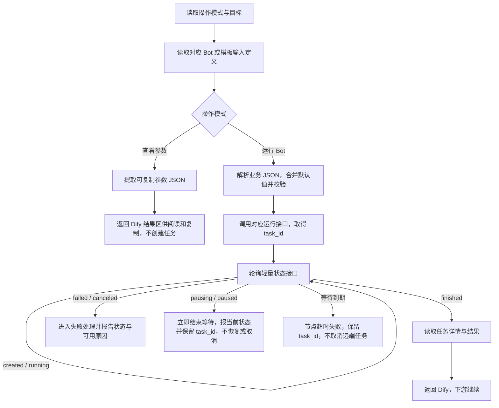

# BrowserAct Dify 插件首版设计方案

2026-10-22 最新增量（13/17票、0.0.7）：两个工具的 Operation 按 Run Bot、View Parameters 排列，默认 run、显式 view 及 JSON 复制解析行为保持不变。共享客户端所有请求统一携带 `api-channel-ak: difyak`，Bearer Key 不变。轮询维持心跳，超时/异常停止查询、不主动取消；服务端可能因心跳过期取消。源码保留生产 API 主机，`scripts/package-test03.py` 在隔离打包时固定 `https://api-test03.browseract.com` 并标注 BrowserAct (Test03)，不增加用户环境配置项。最新验证与包见 Feature 17 票；以下旧版本决定保留历史语义。

2026-10-21最新决定（12票/0.0.6）：两个工具默认Run Bot，显式View Parameters仍只查询；移除模板Proxy Region字段、地区请求与校验，创建请求不传顶层proxy_region；自定义参数JSON灰字说明改为查询参数及官方集成指引链接。此前默认view、模板US必填的内容属于旧版本决定，已被本次用户指令替代。详情与验证以Feature入口的12票为准。

版本：v0.8 评审稿。更新日期：2026-10-19。

状态：用户已确认本轮功能设计文档完成，进入 Feature 启动准备。本文作为后续技术 Spec 和任务拆分的需求输入；尚未完成独立技术评审、正式插件实现或目标 Dify 联调。文中仍标为建议或待验证的技术细节，不因功能设计完成而自动视为已通过。

本次更新：确认用户复制完整 Dify 输出后直接粘贴到自定义参数 JSON，运行前由插件提取 `json[0]` 并忽略外层 `text`、`files`，不再要求手动提取。保留纯参数对象和 `{}` 输入。沿用两个工具入口“运行我的 Bot”和“运行官方模板”，各自保留“查看参数 / 运行 Bot”和 JSON 输入。查看模式进一步精简：仅把可复制修改的参数值对象返回到 `json[0]`，过滤说明、Schema、Bot 信息及额外包装字段，正常 `text` 为空。Dify 自带的 `text/json/files` 外层结构仍保留，不自动回填节点配置。R1、R2 已确认：等待超时只结束节点等待，不取消远端任务，报告超时并保留 `task_id`。用户修订已确定模板代理默认美国、等待超时默认 600 秒；查询到 `pausing/paused` 时立即结束等待，节点报当前状态并保留 `task_id`，不恢复或取消远端任务。R3 已确认对齐 BrowserAct n8n/Zapier 的数据返回方式：返回 API 任务详情 JSON，保留业务结果、文件信息和临时链接，不按字段白名单裁剪，首版不下载转存为 Dify `files`；本轮六项功能澄清已完成：超时不取消、暂停立即结束、结果对齐自家平台、对象逐层合并、模板代理运行时必填默认美国、模式默认查看参数；整体技术评审与验证尚未完成。

本文是本轮评审的统一入口。已确认产品决定以 [01：功能范围](01-tools-and-input.md) 为依据；接口和控件证据分别见 [02：接口编排](02-api-orchestration.md)、[03：输入参数](03-run-inputs.md) 及 research 文档。评审通过后回写对应决定，避免同时维护相互冲突的方案。

## 1. 目标与范围

让 Dify 用户从同一 BrowserAct 插件中选择“运行我的 Bot”或“运行官方模板”工具，先查看所选目标的输入参数并复制默认 JSON，再运行并等待完成，将结果交给下游节点。已了解参数的用户可以直接运行。插件适配 BrowserAct 现有 V3 API，不修改 Dify 本体，不要求 BrowserAct 新增同步执行 API。

### 已确认

- 首版为一个 BrowserAct 插件、两个工具：“运行我的 Bot”和“运行官方模板”，分别加载各自来源的目标列表。
- 两个工具各自在同一节点提供“查看参数”和“运行 Bot”两种模式，新建节点均默认“查看参数”；不按模式拆成四个工具。查看参数不创建任务，用户手动切换到运行模式后才创建任务并同步等待结果。
- 查看模式只从 `input_schema` 提取可复制修改的参数值对象，过滤参数说明、类型、约束、Bot 信息等其他内容。
- Bot 通过动态下拉选择，展示名称、使用对应 ID 运行；关键词搜索不作为首版要求。
- 通用参数独立填写，Bot 业务输入使用 JSON；支持粘贴完整 Dify 输出，插件提取 `json[0]` 后覆盖输入定义中的默认值。
- 插件启动任务后内部轮询，取得最终结果再结束节点；串行下游节点随后使用结果。
- 不提供仅提交任务模式、等待开关、独立查询/取消/恢复工具或回调流程。

### 首版不包含

创建、编辑或发布 Bot；选择 Bot 后自动生成业务参数表单、自动回填 JSON 或动态更新参数说明；点击“运行此步骤”取得输出后自动改写本节点 JSON 配置；历史任务管理；插件内交互式恢复暂停任务。查看参数必须显式单步运行，返回值仍需手动复制。R3 已确认返回业务结果和文件信息/临时链接，首版不下载转存文件；大结果的平台兼容性仍需验证。

## 2. 输入与目标选择

2026-10-20补充决定：操作模式作为两个工具的首个输入，位于目标下拉之前，默认查看参数。动态列表在插件进程内按凭据摘要、SDK用户和来源隔离复用60秒，最多128组，失败不缓存；只减少重复列表请求，不缓存定义、执行前校验或任务。新版本代码及本地验证以Feature记录为准；原v0.8评审时的阶段说明作为历史保留，不能据此推断新包已在Cloud安装验证。

### 用户配置

API Key 在插件连接中配置，节点使用已授权连接。标准插件不新增“连接并加载列表”按钮；本机演示为请求真实 API 设置的密钥输入和加载按钮位于模拟 Dify 窗口之外，仅供调试。建议以下节点输入：

| 输入 | 形式 | 行为与状态 |
| --- | --- | --- |
| 操作模式 | 单选，必填 | 已确认“查看参数 / 运行 Bot”，两个工具新建节点均默认“查看参数”；用户手动切换到运行模式才创建任务 |
| Bot / 官方模板 | 各自工具的动态单选下拉，必填 | 运行我的 Bot 仅列账号已发布 Bot；运行官方模板仅列官方模板，来源无需另填 |
| 代理地区 | 仅模板工具声明地区下拉 | 仅模板运行模式必填，默认美国；必须选择接口提供的有效地区，留空或无效时不启动任务；Bot 工具不声明此字段 |
| 等待超时（秒） | 数值 | 仅运行模式使用；默认 600 秒，允许范围及平台兼容性待验证 |
| 自定义参数 JSON | 文本，初始 `{}` | 仅运行模式使用；粘贴完整查看输出后修改 `json[0]`；也支持纯参数对象或上游 JSON 字符串 |

代理地区的必填性在模板运行时校验：查看参数不要求该值，不因留空或无效而阻止读取定义；不将此要求误写成会阻断查看模式的全模式必填。默认美国应使用地区列表返回的对应值，不用显示名称代替请求值；无法取得有效选项时提示错误，不静默退回服务端默认地区。

两个工具共用同一个 Provider 的已授权连接，不新增来源参数。API Key 不出现在业务 JSON 中，不提供自定义 API 主机地址。查看模式只要求有效连接和所选目标，不要求填写代理地区、等待时限或业务 JSON，也不因业务 JSON 格式错误而阻止查看；不依赖按模式隐藏这些控件。

### R1：按来源拆分工具入口（已确认）

| 工具 | 列表接口 | 详情 / 启动接口 | 模式与输入 |
| --- | --- | --- | --- |
| 运行我的 Bot | `GET /v3/bots` | `/v3/bots/{bot_id}`、`/v3/bots/{bot_id}/runs` | 查看参数 / 运行 Bot，JSON 业务输入 |
| 运行官方模板 | `GET /v3/bots/templates` | `/v3/bots/templates/{template_id}`、`/v3/bots/templates/{template_id}/runs` | 同上，额外声明代理地区 |

采用同一 Provider 注册多个 Tool 的标准结构，参考 [Firecrawl 工具注册](https://github.com/langgenius/dify-official-plugins/blob/f2d7811364193f8d7069f24a299ee465c5519d3c/tools/firecrawl/provider/firecrawl.yaml#L41-L48) 与 [官方 Tool 插件文档](https://docs.dify.ai/en/develop-plugin/dev-guides-and-walkthroughs/tool-plugin)。每个 Tool 的动态选项加载逻辑固定来源，避免依赖兄弟字段上下文；代理地区只在模板工具的固定字段中出现，不使用条件隐藏。

两个工具共享凭据、API 客户端、输入合并校验、任务轮询和结果转换。列表完整处理分页；重复名称通过 ID 区分。列表加载失败时明确提示，不自动启动首个目标；执行前重新读取定义，失效、不可访问或未发布的目标不启动任务。

该决定替代单工具加来源字段及合并来源列表方案。当前不增加关键词搜索或手填 ID 的第二套入口；实际 dynamic-select 控件仍需在目标 Dify 版本联调。

### 业务 JSON 与默认值

运行模式执行前重新读取目标的 `input_schema`，先按下述输入约定提取用户配置，再用其覆盖 Schema 中明确提供的默认值并校验；不把此前查看结果当作永远有效的定义。默认值合并由插件完成，不假定 API 自动填充。

示意：Bot 默认配置为 `{"filters":{"category":"restaurant","limit":10}}`，用户输入 `{"filters":{"limit":20}}`，最终输入为 `{"filters":{"category":"restaurant","limit":20}}`。这是业务参数合并示例，不是实际通用参数或代理地区配置；独立的 `proxy_region` 不参与业务 JSON 合并。

已确认：字段未提供时保留已定义默认值；必填且无默认值时必须由用户补充；`0`、`false` 是有效输入；空输入或 `{}` 表示不覆盖默认值。

合并规则（已确认）：当默认值与用户值在同一路径均为 JSON 对象时，逐层合并；用户未提供的字段保留已有默认值。数组整体替换，不按索引拼接；其他显式用户值覆盖默认值，保留 `0`、`false`、空字符串和 `null`，不因其值为假而回退默认值。空对象与默认对象合并时保留默认字段，不将空对象视为清空指令。合并后的输入仍需符合 Schema；没有默认值的必填项仍须补充。

评审建议：提取后的配置只接收 JSON 对象，语法错误、类型不符或必填缺失时在启动前返回清晰错误。显式空值也必须符合 Schema，不在插件中任意转成默认值。Schema 的具体支持范围在技术实现和验证中明确。

完整输出输入约定（已确认）：

- 主要流程为“复制全部输出 → 整体粘贴 → 修改 `json[0]` → 运行”；不自动回填当前节点输入框。
- 当顶层对象恰好包含 `text`、`json`、`files` 三个键时，按完整 Dify 输出处理：`text` 必须是字符串，`files` 必须是数组，`json` 必须是恰好包含一个对象的数组。仅提取 `json[0]`，外层内容不进入 BrowserAct 请求。
- `json` 为空、包含多个对象、元素不是对象或包装类型不正确时，返回清晰错误且不启动任务，不默取第一项。`json: [{}]` 是有效的空配置，按默认值与必填校验规则处理。
- 其他顶层 JSON 对象继续按纯参数配置处理，空输入或 `{}` 仍表示不覆盖默认值。仅出现名为 `json` 的业务字段不会触发提取；匹配完整包装形状的输入按包装解释。顶层数组、字符串等不是有效配置。
- 仅剥离一层 Dify 输出包装，不递归拆解配置中名为 `text`、`json`、`files` 的业务字段；随后按上述规则逐层合并参数对象。包装提取与业务对象合并是两个步骤；原始大小写、类型和必要转义保持不变。

### 查看参数与复制流程（已确认）

用户选择“运行我的 Bot”或“运行官方模板”工具 → 选择目标 → 选择“查看参数” → 点击 Dify 已有的节点单步运行入口 → 在单个只读结果编辑器中查看整个输出 → 点击“复制全部输出” → 整体粘贴到“自定义参数 JSON” → 修改其中 `json[0]` 的参数配置 → 手动切回“运行 Bot” → 测试正式工作流并发布。

查看模式只读取详情并提取第 6 节约定的参数值对象，不返回参数说明，不调用任务启动、状态轮询或任务结果接口。没有默认值的字段不生成占位值，缺失必填项由运行时校验提示。选择 Bot 本身不自动触发展示、回填或模式切换；点击执行并收到输出后也不自动写回本节点 JSON。不按查看模式新增工具或专用复制按钮。

处理结果并返回输出是标准能力，修改当前节点配置不是同一能力：`create_variable_message()` 创建输出变量，不能通过相同字段名覆写输入配置。首版保留复制流程，或直接用 `{}` 和少量覆盖字段；下游引用上游结果不等于回填当前编辑框。[执行后回填证据](../research/02-bot-input-parameters.md#执行完成后能否回填当前节点的-json-配置)。

查看模式的业务结果是一个参数对象；Dify 原生外层包装仍存在。标准工具插件不能向节点结果区注入独立 JSON 框或专用复制控件，也不能承诺原生复制按钮仅复制业务对象。

2026-10-19 的 [API 实测](../research/evidence/2026-10-19-bot-api/README.md) 已确认两个 Bot 和六个模板可返回输入定义及默认值，其中部分参数没有说明；该证据不代表 Dify 展示和复制体验已联调通过。

## 3. 接口与模块职责

插件由一个 Provider/凭据入口、两个来源固定的工具，以及共享的 BrowserAct API 适配、输入/输出转换和任务等待模块组成。BrowserAct 服务负责真正执行 Bot；Dify 负责保存节点配置并编排上下游。插件不承担 Bot 的创建和维护。

拟使用 9 个主流程接口，均位于 `https://api.browseract.com`，采用 Bearer API Key。查看模式复用读取输入定义的接口，不新增 API：

| 用途 | 接口 |
| --- | --- |
| 加载我的已发布 Bot | `GET /v3/bots` |
| 加载官方模板 | `GET /v3/bots/templates` |
| 加载模板代理地区 | `GET /v3/bots/regions` |
| 读取 Bot 输入定义 | `GET /v3/bots/{bot_id}` |
| 读取模板输入定义 | `GET /v3/bots/templates/{template_id}` |
| 启动 Bot | `POST /v3/bots/{bot_id}/runs` |
| 启动官方模板 | `POST /v3/bots/templates/{template_id}/runs` |
| 内部查询状态 | `GET /v3/bots/runs/{task_id}/status` |
| 获取详情与结果 | `GET /v3/bots/runs/{task_id}` |

R2 已确认不调用取消接口 `POST /v3/bots/runs/{task_id}/cancel`，该接口不纳入首版编排；首版仍使用上述 9 个主流程接口。API 契约以 [BrowserAct OpenAPI](https://docs.browseract.com/openapi_3.json) 为准，完整请求格式不在本文复制维护。

## 4. 执行流程

配置阶段加载目标列表和地区选项。执行节点时读取模式与目标，并读取对应输入定义：查看模式立即提取可复制参数 JSON；运行模式才解析业务 JSON、合并校验并启动任务。



图中轮询仅适用于运行模式，包含间隔等待，不代表连续无间隔请求。两类任务共用同一组状态与详情接口；启动成功不等于执行完成。查看成功仅表示读取了参数定义，不产生 `task_id` 或“任务已完成”的状态。轮询间隔、请求超时与重试参数不在本轮功能评审中预设具体数值。

节点单步运行仅验证当前节点，不自动执行下游；完整工作流执行才按连线继续。查看模式若用于完整工作流，也可能把参数对象交给下游，不承诺自动拦截下游或切换模式。原型中的成功指 Dify 工具节点成功，不是 BrowserAct 任务已完成；内部调用链仅在文档说明，不作为标准插件可新增的画布时间线。

建议输入校验失败不创建任务；任务启动请求结果不明确时，不自动重复创建任务。已取得的 `task_id` 用于后续查询和错误定位。

## 5. 等待、异常与超时

本节任务状态与等待规则仅适用于“运行 Bot”。两种模式都需要处理凭据无效、目标失效或详情读取失败；查看模式不执行任务等待、远端取消或业务输入校验。

### 状态与错误信息的来源

本轮重新核对 V3 OpenAPI：轻量 `/status` 成功查询只返回 `task_id`、`status`、`updated_at`，任务失败、取消或暂停不等于查询请求本身报错。失败详情通过任务详情接口的可选 `task_failure_info.code` 和 `task_failure_info.message` 获取；不能保证每种非成功状态都有原因字段。

| 情况 | API 或插件如何识别 | 错误内容来源 |
| --- | --- | --- |
| 任务失败 | `status=failed` | 读取任务详情中可用的 `task_failure_info`，缺少时提供通用提示及任务标识 |
| 任务取消 | `status=canceled` | 状态可确定已取消；公开契约未保证独立的取消原因内容 |
| 任务暂停 | `status=pausing` / `paused` | 状态可确定正在暂停或已暂停；公开契约未保证独立的暂停原因内容 |
| 插件等待超时 | 插件达到自身等待上限 | 由插件生成等待超时信息；API 状态枚举没有 `timeout`，远端任务可能仍在运行 |

另需区分查询请求失败：例如任务不存在时接口返回 HTTP 400、`code=10112` 和 `msg`，属于查询接口错误，不代表查询成功后发现任务 `status=failed`。插件据状态、任务详情及自身等待时限组织面向 Dify 的反馈，不凭空编造服务端原因或错误码。

### R2：等待超时只结束节点等待（已确认）

达到用户设置的等待超时后，插件停止轮询并结束本次节点等待，以节点失败报告等待超时，保留已取得的 `task_id`。不调用取消或恢复接口，不改变 BrowserAct 远端任务状态；仍在运行的任务继续执行，也可能随后自行完成、失败或暂停。节点超时不能写成远端任务已失败或已停止。

等待超时默认 600 秒。插件需要在目标 Dify 执行限制内留出返回错误信息的时间；600 秒的兼容性、允许范围和轮询参数仍需在目标 Cloud/Community 环境验证。平台直接中断插件时不能保证插件还能返回自定义超时信息或 `task_id`；本条描述的是插件自身可处理的等待超时。

其他未成功完成情况如下；暂停处理已确认，其余条目仍为评审建议：

| 情况 | 建议节点行为 |
| --- | --- |
| 凭据无效、列表加载失败 | 配置或执行时提示可操作的错误，不用空列表伪装成功 |
| JSON 不合法、输入不符合 Schema | 启动前校验，通过 Dify 原生节点失败信息指出字段或格式问题；不承诺在编辑时实时校验或由插件标红字段 |
| `failed` / `canceled` | 读取可用详情，按工具失败反馈状态、原因和 `task_id` |
| `pausing` / `paused`（已确认） | 立即停止轮询并结束等待，节点以失败报告实际查询状态及 `task_id`；不继续等到超时，不恢复或取消远端任务，也不把远端状态改写为 `failed` |
| 查询或读取结果失败 | 返回明确失败及已知 `task_id`，不重新创建任务 |

错误输出保留必要定位信息，避免输出 API Key 或完整敏感输入。是否在 Dify 中继续其他分支由工作流错误处理配置决定；插件不把这些情况伪装为正常取得业务结果。

## 6. 两种模式的结果输出

2026-10-20增量决定：运行结果字段对齐Make，保留本节既有完整任务详情JSON，并仅在run额外返回17个固定命名变量：task_id、log_detail_url、bot_id、bot_type、bot_name、status、created_at、finished_at、input、task_failure_info、output、output_files、download_files、files_expires_at、steps、live_url_info、credit。output_files按格式声明文件子字段，方便下游直接选取download_url；不下载或转存文件。具体声明和验证见Feature的08票。

查看模式的实际返回及完整输出复制/回填规则不变，不发送运行变量。变量声明属于工具级，编辑器可能仍展示运行字段名；这不表示查看模式返回任务数据。不同Bot的业务output保留原始类型，不承诺自动展开Bot特有业务字段。新增变量中的task_id/bot_id为字符串，原始JSON不转换；可选字段缺失时不伪造值。

### 查看参数：仅返回可复制配置（已确认）

两个工具采用相同输出规则：从所选目标的 `input_schema` 提取实际输入字段及其明确默认值，通过标准 JSON 消息直接返回该对象。过滤说明、类型、必填标记、约束、Bot 信息和其他非配置内容；不添加 `parameter_descriptions`、`default_inputs` 等业务包装字段。正常 `text` 为空、`files=[]`。

Google Maps Scraper 的实际参数配置如下。它位于完整输出的 `json[0]`，用户整体复制输出后在此对象中修改值：

```json
{
  "URL": "https://www.google.com/maps",
  "Area": "Los Angeles",
  "Keyword": "restaurant",
  "datalimit": "20"
}
```

保留字段名大小写和原始 JSON 类型，`datalimit` 仍为字符串，`0`、`false`、空字符串不能被丢弃。无默认值的字段不生成假占位值；运行模式仍使用完整 Schema 校验，缺少必填项时提示用户补充。Schema 有效但无可提取默认值时返回 `{}`；未提供 Schema 时返回明确的节点错误，不能伪装成空配置。查看成功不保证默认配置已满足全部运行要求。

Dify 原生结果区仍有固定外层结构，例如：

```json
{
  "text": "",
  "json": [
    {
      "URL": "https://www.google.com/maps",
      "Area": "Los Angeles",
      "Keyword": "restaurant",
      "datalimit": "20"
    }
  ],
  "files": []
}
```

用户点击原生“复制全部输出”，将上述完整结构直接粘贴到“自定义参数 JSON”，仅修改 `json[0]` 中的参数。插件运行前自动提取该对象并忽略外层 `text`、`files`，不要求手动删除包装。本方案不改变 Dify 展示或增加专用复制按钮。值本身需要的 JSON 转义必须保留，不改变实际输入。

目标 Dify Cloud 的实际展示和复制体验尚未联调。查看结果不伪造 `task_id` 或任务完成状态；不会自动写回自定义参数 JSON，用户修改后仍需手动切回“运行 Bot”。[本机演示](../demo/live/README.md) 已同步两个真实 API 工具服务、实时列表及裸配置输出；服务是普通 Python 类，尚未接入 Dify SDK/插件运行环境，不能把演示当成 Dify 联调完成。

### 运行 Bot：R3 结果和文件信息/临时链接（已确认）

成功后对齐 BrowserAct 在 n8n、Zapier 的既有数据返回方式：将 `GET /v3/bots/runs/{task_id}` 返回的任务详情对象通过 Dify 标准 JSON 消息输出，位于 `json[0]`。保留 API 原有字段、结构与类型，不按下表列出的字段重新组装或裁剪；可选字段没有返回时不伪造值。下表只是常见字段说明，不是白名单：

| 内容 | 来源与用途 |
| --- | --- |
| `task_id`、`status` | 任务标识与最终状态 |
| `output` | BrowserAct 业务结果，保留原始对象/字符串类型 |
| `output_files` | 按格式提供的业务结果文件信息 |
| `download_files` | 任务生成的文件信息 |
| `files_expires_at`、`log_detail_url` | 文件有效期信息与任务日志入口 |

这是任务详情对象的返回约定，不承诺每个键都是独立的 Dify 命名输出变量。实际使用 Dify 标准 `json` 输出引用结果，变量路径在联调和使用说明中明确。不根据不同 Bot 动态生成下游业务字段。

首版返回 API 提供的内联结果和文件元数据/临时链接，不下载、转存或重新上传这些文件到 Dify，正常 `files=[]`。内联结果较大时不能声称已返回完整数据；BrowserAct 文档的内联上限为 5 MB，仍须核对 Dify 自身的输出限制。输出过大时给出可操作的文件获取信息；若目标环境无法接收该响应，明确返回输出超限信息及任务定位信息，避免截断后报成功。

临时文件地址可能过期，使用说明需讲清下游及时获取文件的方式。该选择不保证临时链接永久可用；下载转存为 Dify `files` 不属于首版范围。本次对齐范围是结果数据与文件处理，不引入 Zapier 回调、其 `timedOut` 附加字段或 n8n 超时取消行为；已确认的 R2 与暂停处理不变。参考对照见 [各平台结果和文件输出实现](../research/05-result-and-file-outputs.md)。

## 7. 评审决定清单

| 编号 | 已确认决定 | 实现与验证关注点 |
| --- | --- | --- |
| R1（已确认） | 一个插件提供“运行我的 Bot”和“运行官方模板”，各自保留两种模式及 JSON 输入 | 替代来源字段和合并列表候选；两个固定 Schema，代理地区仅在模板工具声明，模板运行时必填且默认美国，查看时忽略 |
| R2（已确认） | 等待到期只结束节点等待，不取消远端任务；节点报告超时并保留 `task_id` | 远端任务按自身状态继续执行；验证节点超时与远端任务状态区分、错误返回时限 |
| R3（已确认） | 对齐自家 n8n/Zapier：返回 API 任务详情 JSON，保留字段与文件链接，不按白名单裁剪、不转存为 Dify `files` | 验证下游 JSON 引用、文件链接有效期及大结果兼容性；正常 `files=[]` |
| R4（已确认） | 参数对象逐层合并，数组整体替换，显式用户值优先 | 验证保留未修改默认字段，并对最终输入进行 Schema 校验 |
| R5（已确认） | 模板运行时代理地区必填且默认美国，查看模式忽略 | 验证有效地区值、留空或无效不创建任务；个人 Bot 不发送该参数 |
| R6（已确认） | 两个工具新建节点都默认“查看参数”，用户手动切到“运行 Bot” | 默认执行只读取定义，不创建任务；不自动切换或回填配置 |

对象逐层合并、数组整体替换已确认；Schema 校验范围和其余异常分支仍按第 2、5 节评审建议处理。等待超时默认 600 秒、模板代理默认美国已由用户修订确定；其他时限、字段技术名称、完整输出 Schema 与 SDK 配置在技术评审中细化。

## 8. 实现前的关键验证与验收方向

以下是后续验证目标，尚未执行，不是通过记录或实施任务清单：

- 目标 Dify 中同一 BrowserAct 插件呈现两个工具并共用连接；Bot 工具只加载已发布 Bot，模板工具只加载官方模板，分页完整，不声明独立来源参数。
- 两个工具新建节点均默认“查看参数”，用户手动切换后保留所选配置；查看模式只调用各自详情接口，不启动任务、不轮询、不生成任务 ID，业务 JSON 无效或运行参数未填写时仍可查看；执行结束不改写当前节点 JSON 配置。
- 查看模式只返回参数值对象，位于 `json[0]`，无说明、Schema 或额外业务包装字段；正常 `text` 为空。结果仍使用 Dify 原生只读 JSON 编辑器，不新增展示组件。
- 参数 JSON 保留大小写和类型，包括 `0`、`false`、空字符串；验证原生按钮复制全部输出，用户可整体粘贴输出并修改 `json[0]`；插件提取配置后仅将业务字段放入 API `input`，不透传包装。验证空数组、多对象、非对象和包装类型错误时不启动任务，同时保留纯参数对象及 `{}` 输入。验证缺少 Schema 时失败、有效 Schema 无默认值时返回 `{}`、缺失必填项由运行时校验提示。
- 模板运行必须携带有效代理地区，默认美国，留空或无效时不创建任务；个人 Bot 不发送该字段、查看模式忽略该值。验证嵌套对象逐层合并、数组整体替换、未提供字段保留默认值；`0`/`false`/空字符串/`null` 保留用户值并按 Schema 校验，缺失必填和格式错误均正确处理。
- 两个来源均能创建真实任务，按 `task_id` 轮询，成功后取得结果，串行下游能读取。
- 失败、取消、暂停、请求异常与超时均有明确反馈，未成功结果不会进入正常成功路径；验证查询到 `pausing/paused` 时立即停止轮询、报当前状态并保留 `task_id`，不自动恢复或取消；验证平台执行限制，插件等待超时后停止轮询、保留任务标识且不调用取消接口。
- 文本/对象结果、文件结果和大结果在实际 Dify 中可用，确认变量路径、输出大小限制及临时链接行为。

评审关注方案是否成立；联调完成后才能声明实际可用。在创建正式 Feature 和进入实现前，按 team-infra 确认仓库注册、Feature 位置和工作分支。当前材料保存在 `dify-plugin/docs/`，不擅自创建团队 Feature 或提交代码。

## 9. 发布方向与证据

插件在独立源码仓库维护，参考 `dify-official-plugins` 的 Provider、Tool、manifest 和打包结构；目标为 Dify Marketplace。完成真实环境验证、公开源码和提交材料后，再按 [Marketplace 提交调研](../research/01-marketplace-submission.md) 执行。本文不代表已经打包、提交审核或上线。

| 资料 | 用途 |
| --- | --- |
| [01：功能范围](01-tools-and-input.md)、[03：输入参数](03-run-inputs.md) | 已确认需求、未决字段与搜索边界 |
| [02：接口编排](02-api-orchestration.md) | 接口清单与早期主流程记录 |
| [动态参数调研](../research/02-bot-input-parameters.md) | Dify SDK、后端和前端的固定提交证据 |
| [原生结果编辑器边界](../research/02-bot-input-parameters.md#原生结果编辑器与插件输出的边界) | 单个只读 JSON 编辑器、整体复制及标准插件不能自定义结果组件的边界 |
| [Bot/模板真实 API 返回](../research/evidence/2026-10-19-bot-api/README.md) | 已完成的只读接口验证、完整响应及派生默认参数 JSON |
| [等待机制调研](../research/03-task-waiting.md) | Firecrawl 内部轮询与 Apify SDK 等待模式 |
| [Make 实查](../research/04-make-input-form.md)、[项目证据入口](../../agent.md) | 现有产品交互、n8n/Zapier 仓库与版本 |
| [BrowserAct V3 OpenAPI](https://docs.browseract.com/openapi_3.json) | 目标、输入定义、任务状态与结果的权威 API 契约 |

本稿由当前对话整理并进行一致性自查，尚未经过独立评审。当前未开发插件、执行真实任务或验证上架包。
